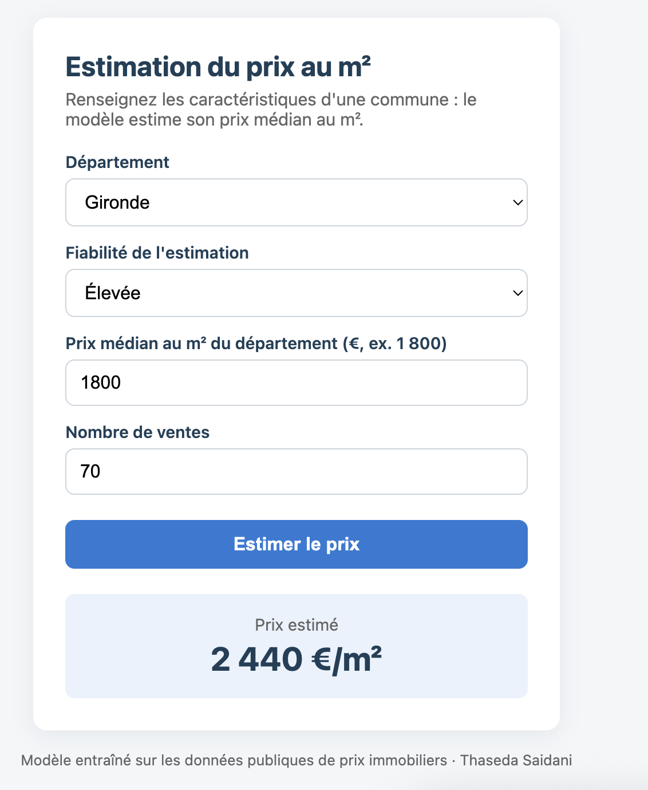

# Estimation du prix au m² — application Flask

Application web qui estime le prix médian au m² d'une commune française
à partir d'un modèle de machine learning (scikit-learn).



## Fonctionnement
1. Le modèle a été entraîné dans un notebook Google Colab sur des données
   de prix immobiliers de 756 communes (données Kaggle).
2. Il est enregistré dans `model.pkl`.
3. L'application Flask charge le modèle, affiche un formulaire et renvoie
   le prix estimé.

## Lancer l'application
```bash
python3 -m venv .venv
source .venv/bin/activate
pip install -r requirements.txt
python app.py
```
Puis ouvrir http://127.0.0.1:5000

## Technologies
Python · Flask · scikit-learn · pandas · HTML/CSS